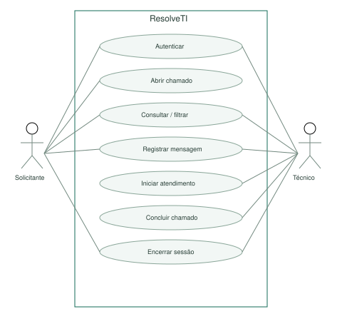
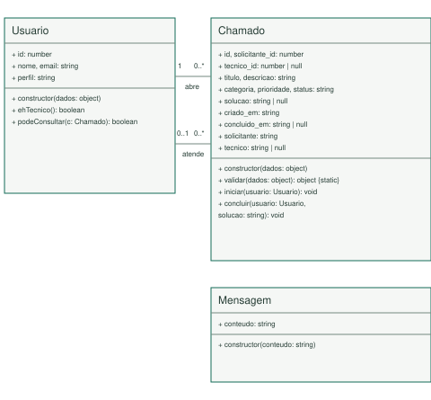
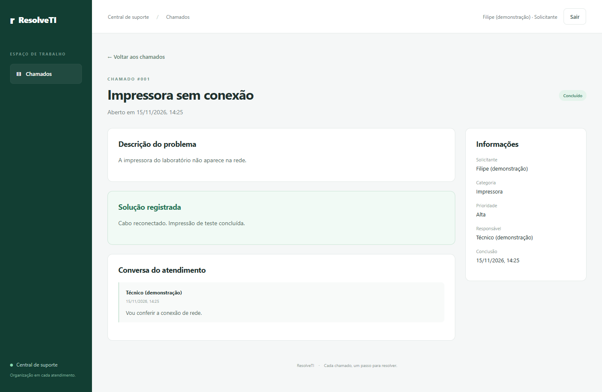

# ResolveTI - documentação consolidada

<b>UNIFRAN · CIÊNCIA DA COMPUTAÇÃO</b>

<b>Central de chamados de suporte técnico</b>

Trabalho Prático de Documentação e Implementação Inicial de um Projeto de Software

<b>Disciplina</b> Análise e Projeto de Sistemas

<b>Integrantes</b> Filipe Silva Rodrigues Segundo integrante a identificar para a entrega em dupla

<b>Repositório público</b> <link href="https://github.com/Filipesilva10/resolveti" color="#156d59"><u>https://github.com/Filipesilva10/resolveti</u></link>

Franca, SP · 15 de novembro de 2026

Projeto acadêmico desenvolvido com assistência de IA.

## 1. Contexto, objetivo e escopo

Problemas de TI recebidos por conversas avulsas dificultam descobrir quem solicitou ajuda, quem assumiu o atendimento e qual solução foi aplicada. O ResolveTI organiza esse ciclo em um registro único, com situação, responsável e histórico de mensagens.

<b>Objetivo:</b> permitir que um solicitante abra e acompanhe chamados e que um técnico organize a fila, assuma atendimentos e registre a solução. O escopo prioriza um sistema pequeno, funcional e explicável no segundo ano de Ciência da Computação.

| Ator | Responsabilidades |
| --- | --- |

| Solicitante | Autenticar-se; abrir chamados; consultar e filtrar seus próprios chamados; enviar mensagens enquanto não concluídos; consultar a solução. |

| Técnico | Autenticar-se; consultar todos os chamados; filtrar; iniciar atendimento; enviar mensagens; concluir somente os chamados sob sua responsabilidade. |

<b>Incluído:</b> login/logout, criação, consulta, filtros, mensagens, atribuição, conclusão e armazenamento SQLite local. O painel apresenta totais dos chamados visíveis ao perfil. Os totais não mudam com o filtro da tabela.

<b>Fora do escopo</b> Cadastro público, recuperação de senha, anexos, notificações, nível de serviço, exclusão ou reabertura de chamados, múltiplas organizações e aplicativo nativo.

<b>Ambientes</b> A execução local usa Node.js 24.14 ou superior e preserva os chamados em um arquivo SQLite. O modo de demonstração usa contas fictícias e recria o banco ao iniciar. Os dois modos executam os mesmos fluxos de chamados.

<b>Origem dos requisitos</b> Os requisitos foram formulados a partir do problema proposto e conferidos contra o código e os fluxos da aplicação.

## 2. Requisitos funcionais

| ID | Requisito e critério de aceitação |
| --- | --- |

| RF-01 | Autenticar: e-mail/senha corretos retornam o perfil; credenciais inválidas são rejeitadas. |

| RF-02 | Abrir: solicitante informa título, descrição, categoria e prioridade; recebe um identificador e status Aberto. |

| RF-03 | Consultar: solicitante vê somente seus chamados; técnico vê todos. Detalhes incluem responsável, mensagens, datas e solução. |

| RF-04 | Filtrar: combinar título/número, situação e prioridade. Busca por título ignora acentos e caixa; número é exato e aceita #001. |

| RF-05 | Iniciar: técnico assume chamado Aberto; passa a responsável e muda status para Em atendimento. |

| RF-06 | Registrar mensagem: solicitante autor ou qualquer técnico registra conteúdo, autor e data, enquanto o chamado não está concluído. |

| RF-07 | Concluir: somente técnico responsável registra solução e data final em chamado Em atendimento. |

| RF-08 | Sair: invalidar sessão no servidor, limpar cookie e retornar ao login. |

<b>Prioridade:</b> todos os requisitos acima pertencem ao núcleo implementado. Melhorias fora do escopo poderão ser planejadas depois da entrega.

## 3. Qualidade e regras de negócio

| ID | Requisito não funcional / verificação |
| --- | --- |

| RNF-01 | Persistência local: reabrir o mesmo arquivo SQLite conserva chamados e mensagens. No modo de demonstração o banco é temporário. |

| RNF-02 | Sessão: cookie HttpOnly, SameSite=Strict; validade de 8 horas e invalidação no logout. Reiniciar o servidor encerra sessões. |

| RNF-03 | Senhas: armazenar hash scrypt com sal individual; não guardar senha em texto puro. Contas demo têm credenciais públicas intencionais. |

| RNF-04 | Interface: formulários utilizáveis em 390px e 1366px; tabela pode ter rolagem própria. Conferência visual e medidas no navegador. |

| RNF-05 | Reprodução: instalar dependências pelo lockfile, iniciar e testar com comandos documentados. |

| ID | Regra |
| --- | --- |

| RN-01 | Título: 5 a 100 caracteres; descrição: 10 a 2000. Espaços nas extremidades são removidos. |

| RN-02 | Categorias: Computador, Internet, Impressora, Sistema, Outro. Prioridades: Baixa, Média, Alta. |

| RN-03 | Novo chamado inicia Aberto, vinculado ao solicitante autenticado. |

| RN-04 | Solicitante consulta e envia mensagens somente nos próprios chamados. |

| RN-05 | Somente técnico assume; somente chamado Aberto pode ser assumido. |

| RN-06 | Somente responsável conclui; deve estar Em atendimento; solução tem 10 a 2000 caracteres. |

| RN-07 | Mensagem tem 1 a 1000 caracteres; chamado Concluído não recebe mensagens. |

## 4. Diagrama de casos de uso

A fronteira delimita o sistema e as linhas associam cada ator aos casos de uso dos quais participa. Os casos protegidos exigem uma sessão ativa criada previamente em Autenticar.

Consultar / filtrar reúne RF-03 e RF-04. Os demais casos correspondem diretamente a RF-01, RF-02 e RF-05 a RF-08. A autorização por chamado é aplicada no servidor, além da visibilidade dos botões.

## 5. Especificação dos casos de uso

<b>UC-01 Autenticar</b>

<b>Ator:</b> Ambos <b>Precondição:</b> Conta previamente cadastrada. <b>Fluxo principal:</b> Informar e-mail/senha; servidor verifica hash; cria sessão; interface carrega chamados do perfil. <b>Alternativas:</b> Credenciais inválidas: informar erro. Mais de 15 tentativas na janela de um minuto: responder 429. <b>Exceções:</b> falha de rede apresenta erro; sessão expirada exige novo login nos casos protegidos; erro de banco retorna falha sem mensagem de sucesso. <b>Pós-condição:</b> Usuário autenticado por até 8 horas.

<b>UC-02 Abrir chamado</b>

<b>Ator:</b> Solicitante <b>Precondição:</b> Sessão válida. <b>Fluxo principal:</b> Abrir Novo chamado; preencher campos; enviar; servidor valida; insere registro; exibe detalhes. <b>Alternativas:</b> Campo inválido: rejeitar sem inserir. Técnico tentando abrir: negar. <b>Exceções:</b> falha de rede apresenta erro; sessão expirada exige novo login nos casos protegidos; erro de banco retorna falha sem mensagem de sucesso. <b>Pós-condição:</b> Chamado Aberto com solicitante e data de criação.

<b>UC-03 Consultar e filtrar</b>

<b>Ator:</b> Ambos <b>Precondição:</b> Sessão válida. <b>Fluxo principal:</b> Carregar lista permitida; escolher busca/status/prioridade; abrir detalhes de um resultado. <b>Alternativas:</b> Sem resultados: exibir estado vazio. ID inexistente ou não autorizado: 404. <b>Exceções:</b> falha de rede apresenta erro; sessão expirada exige novo login nos casos protegidos; erro de banco retorna falha sem mensagem de sucesso. <b>Pós-condição:</b> Lista/detalhes exibidos; nenhum dado alterado.

<b>UC-04 Iniciar atendimento</b>

<b>Ator:</b> Técnico <b>Precondição:</b> Chamado Aberto. <b>Fluxo principal:</b> Abrir detalhes; acionar Iniciar atendimento; registrar técnico responsável e novo status. <b>Alternativas:</b> Solicitante, chamado já assumido ou concluído: rejeitar. <b>Exceções:</b> falha de rede apresenta erro; sessão expirada exige novo login nos casos protegidos; erro de banco retorna falha sem mensagem de sucesso. <b>Pós-condição:</b> Chamado Em atendimento e responsável definido.

## 6. Casos de uso e estados

<b>UC-05 Registrar mensagem</b>

<b>Ator:</b> Autor do chamado ou técnico <b>Precondição:</b> Sessão válida; chamado não concluído. <b>Fluxo principal:</b> Preencher texto; enviar; validar acesso/conteúdo; salvar autor e data; atualizar conversa. <b>Alternativas:</b> Conteúdo vazio/maior que 1000 ou chamado concluído: rejeitar. Acesso de outro solicitante: 404. <b>Exceções:</b> sessão expirada exige novo login; falha de rede apresenta erro; falha de persistência não informa sucesso. <b>Pós-condição:</b> Mensagem persistida e visível na conversa.

<b>UC-06 Concluir chamado</b>

<b>Ator:</b> Técnico responsável <b>Precondição:</b> Chamado Em atendimento atribuído ao usuário. <b>Fluxo principal:</b> Preencher solução; concluir; validar responsável e conteúdo; salvar status, solução e data final. <b>Alternativas:</b> Outro técnico, solicitante, status incorreto ou solução fora de 10-2000 caracteres: rejeitar. <b>Exceções:</b> sessão expirada exige novo login; falha de rede apresenta erro; falha de persistência não informa sucesso. <b>Pós-condição:</b> Chamado Concluído; solução visível; novas mensagens bloqueadas.

<b>UC-07 Encerrar sessão</b>

<b>Ator:</b> Ambos <b>Precondição:</b> Sessão válida. <b>Fluxo principal:</b> Acionar Sair; excluir token do mapa de sessões; limpar cookie e formulários; mostrar login. <b>Alternativas:</b> Sessão expirada: mostrar login. Falha de rede: apresentar erro. <b>Exceções:</b> sessão expirada exige novo login; falha de rede apresenta erro; falha de persistência não informa sucesso. <b>Pós-condição:</b> Token anterior deixa de autorizar requisições.

| Estado de origem | Ação | Estado de destino |
| --- | --- | --- |

| Criação | Solicitante abre | Aberto |

| Aberto | Técnico assume | Em atendimento |

| Em atendimento | Responsável registra solução | Concluído |

Não há transições de retorno, reabertura ou transferência de responsável nesta versão. Registrar mensagem não altera o estado.

## 7. Classes de análise e projeto

<b>Análise:</b> Usuario representa o participante; Chamado representa a solicitação e seu ciclo; Mensagem representa o conteúdo de uma interação. Interfaces de login/lista/formulário/detalhes são fronteiras; rotas HTTP coordenam as ações; SQLite armazena as entidades.

Diagrama de projeto: classes exportadas por src/modelos.js. “+” indica membro público; validar é estático. Perfis são valores de Usuario, não subclasses. Um usuário abre zero ou muitos chamados; cada chamado tem um solicitante. Um técnico atende zero ou muitos chamados; cada chamado tem zero ou um técnico.

Mensagem valida conteúdo; ID, autor e chamado são persistidos pela rota. Os relacionamentos mostrados são associações, resolvidas por IDs/SQL; não há herança ou composição de objetos. Parâmetros object são registros com os atributos indicados; validar retorna título, descrição, categoria e prioridade validados. Construtores criam a própria instância, sem tipo de retorno em UML.

## 8. Repositório e acesso à implementação

<b>Repositório Git público</b> <link href="https://github.com/Filipesilva10/resolveti" color="#156d59"><u>https://github.com/Filipesilva10/resolveti</u></link>

O repositório contém a implementação, os testes, os diagramas e os arquivos de entrega. O README explica como executar o projeto. O histórico registra a abertura inicial de chamados, a integração do atendimento, a correção móvel e a preparação da demonstração.

<b>Roteiro de avaliação</b> Entre como solicitante e abra um chamado. Troque para o técnico, filtre pelo título e inicie o atendimento. Envie uma mensagem e conclua com uma solução. Retorne ao solicitante e confira a situação e a solução nos detalhes.

<b>Entregáveis previstos no enunciado</b> PDF consolidado, vídeo MP4 de até um minuto e link do repositório público. A submissão é pela BB até 18/11/2026 às 21h. Em dupla, o enunciado exige commits dos dois integrantes.

## Apêndice A. Modelo de dados

| Tabela | Campos e restrições |
| --- | --- |

| usuarios | id INTEGER PK; nome TEXT obrigatório; email TEXT obrigatório e UNIQUE; senha TEXT obrigatório (sal:hash); perfil TEXT com CHECK solicitante/tecnico. |

| chamados | id INTEGER PK; titulo, descricao, categoria, prioridade TEXT obrigatórios; status TEXT obrigatório com DEFAULT Aberto e CHECK dos três estados; solicitante_id FK obrigatório; tecnico_id FK opcional; solucao TEXT opcional; criado_em TEXT obrigatório; concluido_em TEXT opcional. |

| mensagens | id INTEGER PK; chamado_id FK obrigatório com ON DELETE CASCADE; autor_id FK obrigatório; conteudo TEXT obrigatório; criado_em TEXT obrigatório. |

<b>Cardinalidades persistidas:</b> Usuario 1 para 0..* Chamado como solicitante; Usuario 0..1 para 0..* Chamado como técnico; Chamado 1 para 0..* Mensagem; Usuario 1 para 0..* Mensagem como autor. Cada mensagem tem exatamente um chamado e um autor.

As chaves estrangeiras ficam ativas com PRAGMA foreign_keys = ON. IDs são gerados pelo SQLite. Datas são strings ISO 8601 UTC e formatadas para pt-BR na interface. Categorias, prioridades, comprimentos e transições são validados no domínio/rotas; não há CHECK de todas essas regras no banco.

O arquivo padrão é dados/resolveti.sqlite. O diretório e as três contas de demonstração são criados no primeiro uso. Não são inseridos chamados automaticamente. O banco local não é versionado. A exclusão em cascata é uma regra estrutural; não existe rota de exclusão na aplicação.

<b>Rastreabilidade:</b> RF-01/RF-08 usam usuarios e o mapa de sessões; RF-02/RF-03/RF-04/RF-05/RF-07 usam chamados; RF-06 usa mensagens e usuarios. RN-01/RN-02/RN-05/RN-06/RN-07 aparecem em modelos.js; RN-03/RN-04 são aplicadas pelas rotas e consultas.

## Apêndice B. Arquitetura e implementação

| Camada / arquivo | Papel |
| --- | --- |

| public/index.html e style.css | Estrutura das telas, formulários e aparência responsiva. |

| public/app.js e filtros.js | Eventos, fetch, montagem segura do DOM com textContent, busca e filtros em memória. |

| src/server.js | Abre banco e servidor HTTP em 127.0.0.1:3001. |

| src/app.js | Rotas Express, sessão, autorização, validação de entrada e comandos SQL parametrizados. |

| src/modelos.js | Usuario, Chamado e Mensagem: regras de domínio simples. |

| src/banco.js | Schema, contas demo, hash de senhas e abertura SQLite. |

| test/ | Testes de rotas/domínio, persistência e filtros. |

Fluxo: navegador envia JSON via fetch; Express verifica sessão e perfil, aplica regras, consulta ou altera SQLite e devolve JSON. A interface atualiza o conteúdo. Não há framework de interface, ORM, compilação ou serviço de banco separado.

| Método / rota | Finalidade |
| --- | --- |

| POST /api/login; GET /api/eu; POST /api/sair | Autenticar, recuperar sessão e sair. |

| GET /api/chamados; POST /api/chamados | Listar conforme perfil e criar. |

| GET /api/chamados/:id | Consultar detalhes e mensagens. |

| POST /api/chamados/:id/iniciar | Assumir atendimento. |

| POST /api/chamados/:id/mensagens | Registrar mensagem. |

| POST /api/chamados/:id/concluir | Registrar solução e encerrar. |

As senhas usam scrypt com sal. O cookie tem HttpOnly e SameSite=Strict e recebe Secure sob HTTPS. Alterações exigem JSON, as consultas SQL usam parâmetros e a interface insere conteúdo com textContent. Sessões e limite de tentativas ficam na memória de um processo. Essas escolhas atendem ao uso acadêmico com contas fictícias.

## Apêndice C. Validação e evidências

<b>Automação:</b> 19 testes aprovados. As requisições passam pelo Express com transporte em memória e bancos temporários; não usam servidor HTTP real. Cobrem criação, validação, privacidade entre solicitantes, atribuição, mensagens, conclusão, persistência e filtros.

<b>Navegador:</b> em 15/11/2026 foram executados login, abertura, busca combinada com prioridade, início, mensagem, solução e consulta pelo solicitante. Após concluir, o formulário de mensagens ficou oculto. Houve correção do transbordamento móvel causado pelo elemento acessível do cabeçalho da tabela; após correção, viewport e largura da página mediram 390px e campos ficaram dentro da tela.

| Requisitos | Caso de uso | Evidência |
| --- | --- | --- |

| RF-01, RF-08 | UC-01, UC-07 | Login, perfil e invalidação da sessão. |

| RF-02, RF-03, RF-04 | UC-02, UC-03 | Validação, acesso por perfil e filtros combinados. |

| RF-05, RF-06, RF-07 | UC-04 a UC-06 | Atribuição, mensagem com autor e encerramento por responsável. |

| RNF-01, RNF-04 | UC-02, UC-03 | Chamado preservado ao reabrir o arquivo local e formulário conferido em 390 px. |

Figura. Chamado concluído visto pelo solicitante após o atendimento.

## Apêndice D. Execução, Git e entrega

<b>Executar a partir do GitHub:</b> git clone https://github.com/Filipesilva10/resolveti.git cd resolveti npm ci npm test npm start Abrir http://localhost:3001

Requer Node.js 24.14+ e Git para clonar. Contas: solicitante@resolveti.local, ana@resolveti.local e tecnico@resolveti.local. Senha: Demo@123. Os botões da tela de login preenchem os dois perfis principais. Ctrl+C encerra o servidor.

<b>Arquivos no repositório</b> entrega/ResolveTI-documentacao.pdf entrega/ResolveTI-demonstracao.mp4 docs/VALIDACAO.md

<b>Referências</b> Enunciado do trabalho prático, consultado em 15/11/2026. <link href="https://irradiated-worm-914.notion.site/3f9115cb767d800f873de9342b54bcd9" color="#156d59"><u>https://irradiated-worm-914.notion.site/3f9115cb767d800f873de9342b54bcd9</u></link>

Implementação e testes do ResolveTI. <link href="https://github.com/Filipesilva10/resolveti" color="#156d59"><u>https://github.com/Filipesilva10/resolveti</u></link>
